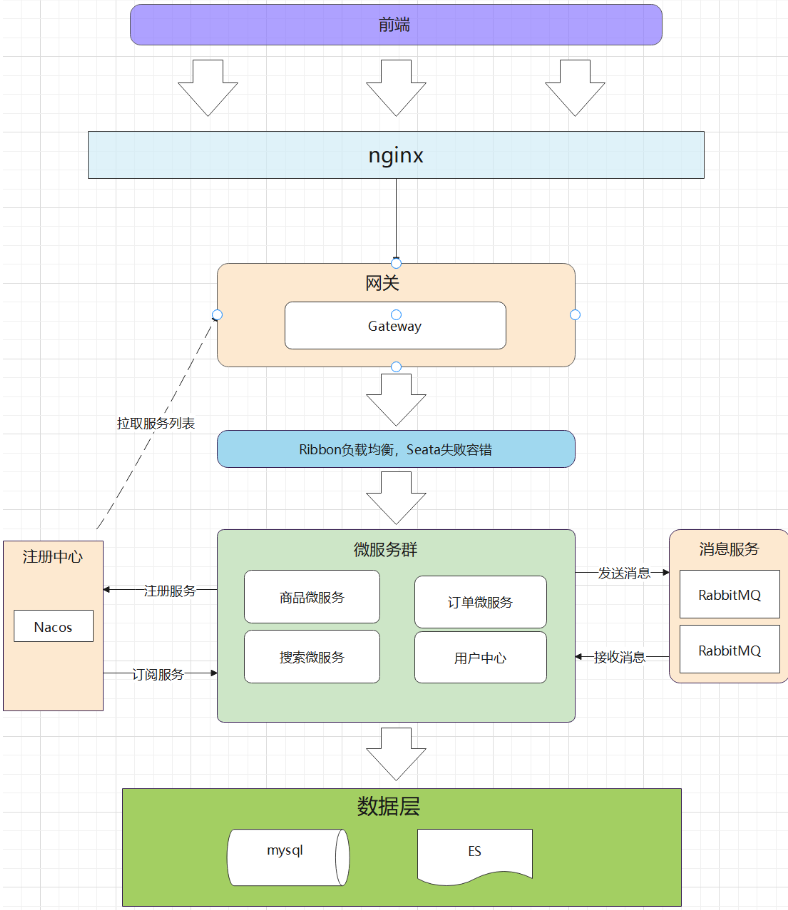
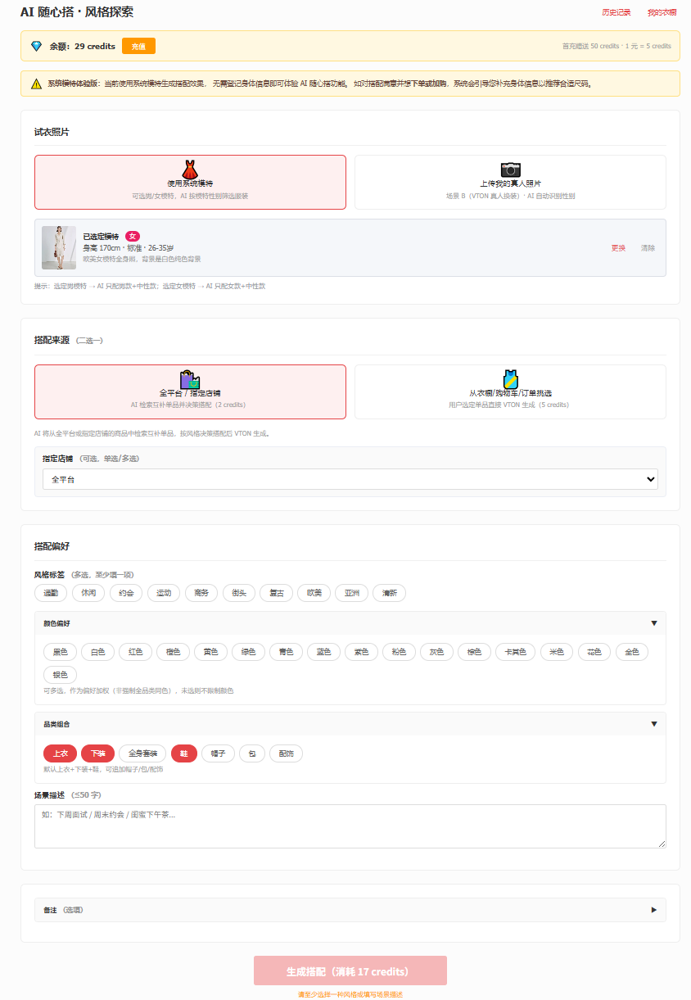
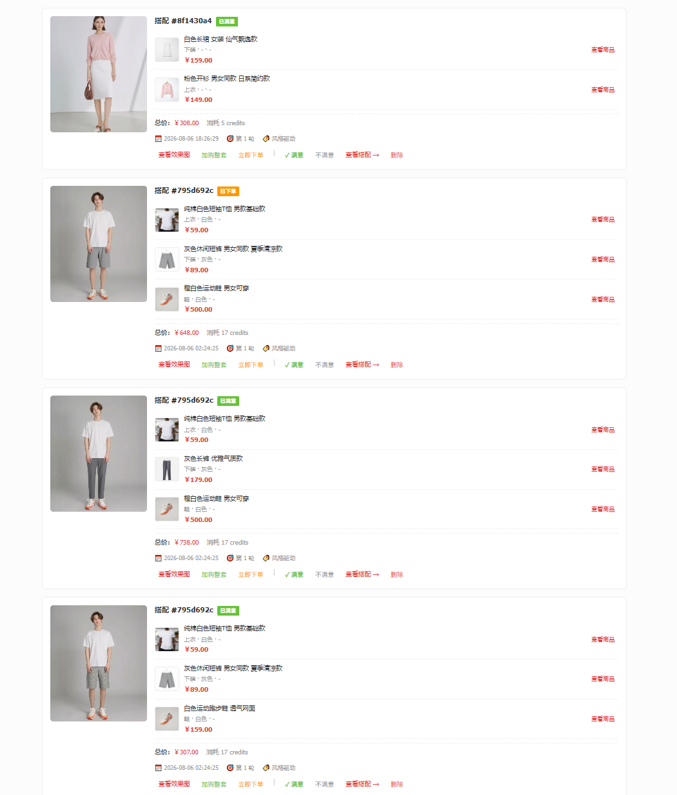
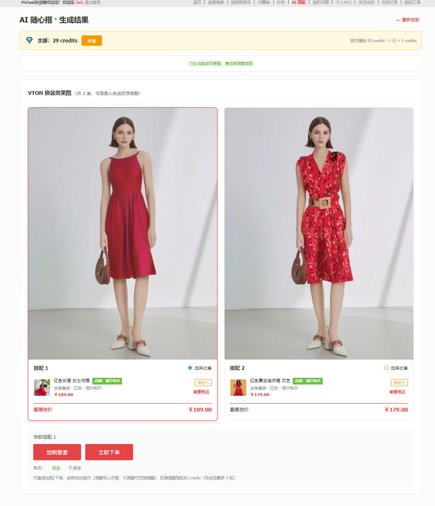

# ZMall 潮流服装智能电商平台

## 项目介绍

自研项目，ai功能从产品思考到Coding实现，专注于潮流服装穿搭的电商平台，ZMall 是基于 **Spring Cloud Alibaba** 微服务架构构建的分布式电商平台，从用户自主挑衣服下单到agent帮用户挑衣服再到下单，衣橱捆绑用户的穿搭喜好，为 C 端用户提供完整的购物闭环，并为商家提供店铺运营与 AI 模特工具。系统前端包含**用户商城门户**、**商家管理后台**；后端由多个 Java 业务微服务与两个 Python AI 智能服务协同组成，AI 服务通过 RabbitMQ、WebSocket 、nacos 与 Java 核心服务联动。

前期参考：视频学习：[《黑马商场-微服务开发与实战》](https://github.com/up0to1/ZMall/blob/main/bilibili.com/video/BV1S142197x7?p=1) 资料学习：[《微服务框架》](https://b11et3un53m.feishu.cn/wiki/PsyawI04ei2FQykqfcPcmd7Dnsc) 参考项目：[黑马商城hmall](https://github.com/fangshuiyun/hmall)、[苍穹外卖](https://github.com/up0to1/sky-take-out)、[黑马点评](https://github.com/up0to1/Hm-dianping)

后期完善实现：

**业务功能**：商品检索浏览、购物车管理、订单交易与支付、优惠券（领取 / 购买 / 秒杀）、商家店铺与评价管理、社交 Feed 流推送，以及高并发商品秒杀、优惠券秒杀。

**智能功能**：

- **AI 随心搭**（用户端）：支持风格驱动、用户选定、商品驱动三种入口，依托 LangGraph 编排一次性直出换装结果，并提供多轮反馈、衣橱收藏、尺码推荐。
- **AI 模特**（商家端）：商家选择商品与模特图，AI 链式换装生成商品展示图，支持链式 VTON、多换装、多姿势三种模式，可评分、发布并沉淀到系统模特图池。
- **credits 积分配额体系**：统一计量 AI 功能用量，通过预扣 / 确认 / 回滚接口与钱包余额联动，保证并发计费可靠。

**技术架构**：基于 Nacos 服务注册与配置中心；Gateway 统一鉴权与请求路由，承载 AI 实时推送的 WebSocket 反向代理；Redis 承担缓存预热与秒杀预减库存；RabbitMQ 承担 AI 任务下发、结果回流与商品库同步；Qdrant 向量库支撑穿搭语义检索与个性化画像融合。

## 技术栈

### 前端

- **Vue 2 / Element UI**：商家后台与新款管理后台
- **Nginx**：三站点静态托管、反向代理与 WebSocket 透传

### Java 后端

- **Spring Cloud / Spring Boot**：微服务治理与应用开发框架
- **Gateway**：API 网关，统一入口、限流与登录校验
- **OpenFeign**：声明式服务间远程调用
- **Sentinel**：流量控制、熔断降级、线程隔离
- **Seata**：分布式事务（AT 模式）
- **MyBatis-Plus**：ORM 框架，简化单表 CRUD

### 中间件

- **Redis**：缓存、分布式锁、热点 Key 预热、配额冻结
- **Nacos**：服务注册与配置中心
- **RabbitMQ**：消息队列，任务下发、结果回流、商品库同步、延迟与死信处理
- **Docker**：容器化部署

### Python 后端

- **FastAPI**：高性能异步 Web 框架
- **LangGraph**：AI Agent 编排框架
- **WebSocket**：实时双向推送

### 大模型服务

- **阿里云（DashScope / 通义千问）**：视觉理解、Embedding 向量编码
- **千问 Virtual Try ON**（VTON）：虚拟换装生成

### 数据库

- **MySQL**：关系型数据库，核心业务数据存储
- **Qdrant**：向量数据库，支持语义检索
- **阿里云 OSS**：对象存储，图片与静态资源托管

### 测试工具

- **JMeter**：高并发压测与性能基准
- **Postman**：接口调试与自动化测试

## 需求分析

### 用户端

- **商品浏览**：商品分类、搜索、详情查看、浏览记录
- **购物车**：添加 / 删除商品、修改数量
- **订单交易**：下单、支付、订单状态查询、尺码推荐
- **优惠券**：免费领取、付费购买、秒杀抢券，支持多种优惠类型
- **AI 随心搭**：风格驱动 / 用户选定 / 商品驱动一键智能搭配，多轮反馈、保存衣橱、一键加购下单
- **智能衣橱**：单品、全身照、自拍、AI 效果图管理与点赞
- **用户中心**：个人信息、收货地址、身体档案、credits 积分账户、偏好管理

### 管理端

- **商品管理**：商品上下架、库存管理、尺码对照表
- **AI 模特**：商品 + 模特图换装生成展示图、多模式批量生成、评分发布、反馈
- **优惠券管理**：创建、发放、审核，秒杀活动配置
- **订单管理**：订单查询、发货处理
- **用户管理**：用户信息查看与统计
- **商家运营**：店铺资料、关注与评价、运营数据看板

### 非功能需求

- **高并发**：秒杀场景支持高并发访问，Redis 预减库存 + MQ 异步下单削峰
- **高可用**：服务无单点故障，支持限流熔断与降级
- **数据一致性**：分布式事务 + 幂等对账保证订单、库存与积分一致
- **安全性**：网关统一鉴权，STS 临时凭证直传 OSS，防越权

## 微服务

项目采用单工程多模块（module）的组织方式，代码中原先的单体功能被拆为独立业务服务，每个服务访问独立库表、独立部署。业务微服务列表如下：

### 业务微服务（Java）

| 服务 | 主要职责 |
|------|---------|
| `user-service` | 用户注册登录、地址、credits 积分账户、身体档案、浏览记录、衣橱 |
| `item-service` | 商品、分类、搜索、尺码对照表、AI 模特图生成与评分/发布 |
| `cart-service` | 购物车管理 |
| `trade-service` | 订单、优惠券、秒杀（商品秒杀 + 优惠券秒杀） |
| `pay-service` | 支付订单、支付回调 |
| `social-service` | 店铺、关注/评价、商家资料、Feed 流 |
| `dashboard-service` | 商家运营数据看板 |

### 智能服务（Python）

| 服务 | 主要职责 |
|------|---------|
| `ai-outfit` | AI 随心搭：风格驱动 / 用户选定 / 商品驱动，LangGraph 编排 + 链式 VTON，意图理解 → 向量检索 → 搭配决策 → Reflection 自检 → 换装生成 |
| `ai-models` | AI 模特：链式 VTON + LLM 多 Agent 决策，支持单图 / 多换装 / 多姿势三种模式 |
| `shared` | 两个服务共享的公共模块：Nacos 注册与发现、RedisCache、Qdrant 客户端、OSS 客户端、Java 调用客户端、MQ、WebSocket 管理器等 |

### 基础设施

网关与公共工程**不属于业务微服务**，作为平台基础设施统一提供：

| 模块 | 职责 |
|------|------|
| `hm-gateway` | 统一入口，JWT 登录校验、请求路由（含 AI 路径与 WebSocket 透传） |
| `hm-api` | OpenFeign 接口与公共 DTO，服务间远程调用契约 |
| `hm-common` | 公共工具、统一响应 / 异常、Redis 工具等 |

整体架构示意：




## 功能设计

### Feed 内容推送

基于用户行为与偏好，通过 WebSocket 实时推送个性化商品推荐与话题活动，提升用户活跃度与转化率。

### 缓存预热

针对秒杀、热门商品等高并发场景，系统采用**三层缓存预热机制**协同工作，避免缓存击穿导致数据库压力过大：

1. **秒杀自动预热（主动 · 定时任务）**：`trade-service` 定时任务每 1 分钟扫描秒杀商品 / 优惠券表，对秒杀开始前 5 分钟内且尚未过期的数据，写入秒杀库存、商品详情、订单记录、用户购买计数等 6 类 Redis key，TTL 覆盖整个秒杀周期，兜底同步只降不抬防止库存漂移。
2. **人工按钮预热（手动 · 管理员触发）**：秒杀 / 优惠券管理页提供「手动缓存预热」按钮，调用与自动预热一致的 `doPreheatItem` / `doPreheatCoupon`，用于临时加活动或自动预热失效时的应急兜底。
3. **热点 Key 探测（被动 · AOP + ZSet）**：`@HotKeyCache` 注解 + AOP 切面被动统计访问频次，Redis ZSet 在 30 秒窗口内访问 ≥ 50 次判定热点。缓存策略自适应：热点 30 分钟、非热点 5 分钟、空值 2 分钟；Redis 异常时降级为直接执行业务方法。用于普通商品详情页的突发热点，秒杀场景由机制 1/2 覆盖。

三机制协同：机制 1/2 负责已知热点（秒杀），写入长 TTL；机制 3 负责未知热点（普通商品突发流量），自适应 TTL。机制 1/2 命中时机制 3 只做计数不重复写缓存。

### 秒杀功能

支持商品秒杀与优惠券秒杀两种模式：Redis 预减库存 + 消息队列异步下单，削峰保护 MySQL，保障高并发下的系统稳定与数据一致。

### 一人一单 / 一人多单

- **一人一单**：Redis 分布式锁 + 用户 ID 唯一索引，确保同一用户对同一秒杀商品仅能下一次单。
- **一人多单**：支持单人多次领取 / 购买优惠券，通过 `perUserLimit` 控制领取上限。
- **全局唯一 ID**：基于雪花算法（Snowflake）生成分布式全局唯一 ID，兼顾高性能与趋势递增。

### AI 随心搭

面向 C 端用户的智能穿搭推荐，支持**系统模特**与**自拍照**（需登记身体档案）两种照片模式，共享同一 credits 配额池与 LangGraph 工作流。

**三种入口**：

| 入口 | 触发方式 | 扣费 | 生成路径 |
|------|---------|------|---------|
| 风格驱动 | 填写风格 / 颜色 / 品类 / 店铺 / 场景，从全平台/指定店铺中AI帮你找衣服 | 17 | 一阶段直出：检索决策 + Top3 换装一次完成 |
| 用户选定 | 从衣橱 / 购物车 / 订单 / 搜索结果选单品 | 5 | 选定商品 + 模特图直接 VTON |
| 商品驱动 | 商品详情页点击 AI 搭配 | 5 | 单商品直接生成换装图 |

**工作流**（LangGraph 编排，异步执行，失败自动降级不阻塞主流程）：

- **意图理解**：结构化字段透传 + LLM 解析自然语言备注 + 天气 / 季节感知 + 性别确定（系统模特 > 自拍分析 > 身体档案）
- **向量检索**：Qdrant 按品类 / 店铺 / 颜色 / 性别 / 季节过滤，指定店铺缺货时跨店补全
- **搭配决策**：Top10 候选 → LLM 选 Top3 并给出推荐理由，结合用户画像、历史搭配与跨会话去重
- **Reflection 自检**：校验颜色协调 / 风格一致 / 季节匹配，不合格从候选池替换，最多修正 1 次
- **链式 VTON**：多件商品依次换装生成效果图 → OSS 上传 → WebSocket 实时推送

**多轮反馈**：不满意可反馈调整，每轮扣 5 credits、同会话最多 3 轮。支持点哪换哪（替换单件单品）、换一套重新搭、整体不协调重来，可勾选不喜欢的颜色 / 商品，前端结构化字段优先、LLM 解析兜底。

**结果操作**：满意可加购整套（尺码确认弹窗批量推荐尺码）、立即下单、保存到衣橱；生成结果自动写入搭配历史，供回看与复购。

**个性化**：基于用户行为信号构建风格画像，注入检索向量融合提升相关性；不喜欢颜色 / 风格 / 价格区间等偏好跨会话持久化，并做跨会话去重避免重复推荐。

### AI 模特

商家选择商品（1-4 件，含品类冲突校验）后**异步任务**生成展示图：Java 校验入队 → RabbitMQ 下发 → Python 链式 VTON 生成 → 结果回流 Java 更新任务状态并确认 / 回滚 credits → WebSocket 推送商家前端。支持单图 / 多换装 / 多姿势三种模式，可选 LLM 多 Agent（衣品、摄影、灯光、化妆、导演）策划与评估，质量不达标时图像后处理精修。商家可评分、发布到商品主图、填写拒绝原因，高质量图自动沉淀到系统模特图池供全平台复用。

### 积分配额体系

AI 功能统一使用 credits 计费（1 元 = 5 credits），首充赠送 50。预扣（`deduct`）后成功确认（`confirm`）或失败回滚（`rollback`），未消耗冻结记录存于 Redis；优先扣赠送（30 天有效）再扣充值（永久），FIFO 按过期时间。多轮反馈每轮独立扣费；评分发布、详细填写拒绝原因可获奖励 credits。

### WebSocket 实时推送

用户端 `/ws/ai/{userId}`、商家端 `/ws/model/{userId}`，按 userId 建连保证多开页面均收到推送；连接建立后首条消息携带 JWT token 完成鉴权；客户端 30 秒心跳保活，前端未收到推送时用 taskId 轮询兜底。

## 重点技术总结

- **秒杀链路**：Redis 预减库存 + MQ 异步下单削峰，一人一单分布式锁，缓存预热三种机制协同，防超卖且数据最终一致。
- **热点 Key 探测**：AOP 注解 + Redis ZSet 滑动窗口判定热点，自动自适应缓存 TTL，异常降级保障业务可用。
- **AI 随心搭**：LangGraph 编排一阶段直出，结合 LLM + Qdrant 向量检索 + Reflection 自检 + 链式 VTON，失败自动降级；用户画像向量融合提升个性化。
- **AI 模特**：LLM 多 Agent 策划 / 评估与链式 VTON 执行分离，质量决策层失败降级不阻塞，异步任务状态机（PENDING / PROCESSING / SUCCESS / FAILED / TIMEOUT）+ 超时回滚。
- **积分配额**：预扣 / 确认 / 回滚闭环，Redis 冻结 + 分布式锁保证并发计费幂等，赠送与付费差异化有效期。
- **消息驱动**：RabbitMQ 解耦 AI 任务下发 / 结果回流 / 商品库同步，支持死信队列与超时对账。
- **双通道推送**：WebSocket 实时推送 + taskId 轮询兜底，断连自动切换，前端幂等去重。
- **分布式事务**：Seata AT 模式保证订单与库存同提交 / 同回滚，最终一致。

## 系统展示







## 测试流程

本项目使用 **JMeter** 对秒杀功能进行高并发压力测试，验证防超卖、限购、Redis 与 DB 数据一致性等核心场景。测试前需通过 Spring Boot Test 批量注册用户并生成 Token CSV，然后使用 JMeter 测试计划模拟多用户并发下单。

### 测试工具

- **JMeter 5.6.3**：压力测试与性能基准，支持高并发线程组、同步定时器、BeanShell/Groovy 脚本
- **Spring Boot Test**：批量注册测试用户并签发 JWT Token
- **Redis CLI**：验证 Redis 库存、用户购买记录等缓存数据
- **MySQL CLI**：验证 `sold_stock`、订单记录等数据库数据

### 测试前准备

#### 批量注册用户与 Token 生成

测试前需运行 [BatchRegisterTest.java](./zmall/user-service/src/test/java/com/hmall/user/BatchRegisterTest.java) 批量注册1000个测试用户，并生成 Token CSV 文件供 JMeter 使用。

```java
@SpringBootTest(webEnvironment = SpringBootTest.WebEnvironment.NONE)
@ActiveProfiles("test")
class BatchRegisterTest {
    @Test
    void batchRegisterUsers() { ... }  // 批量注册用户并写入 CSV
    @Test
    void refreshTokens() { ... }       // Token 过期后刷新
}
```

运行 `batchRegisterUsers` 测试方法后会生成以下文件：

- `users_tokens.csv`：主 CSV 文件（1000用户）
- `users_tokens_r1.csv`：第1-40用户（第一轮测试）
- `users_tokens_r2.csv`：第41-80用户（第二轮测试）
- `users_tokens_r3.csv`：第81-120用户（第三轮测试）

Token 过期后运行 `refreshTokens` 方法即可刷新，4 个 CSV 文件会自动同步更新。

### JMeter 测试计划核心讲解

测试计划文件：[ZMall测试.jmx](./ZMall测试.jmx)

#### 整体结构

```
<TestPlan serialize_threadgroups="true">  <!-- 串行执行线程组 -->
  <CSVDataSet filename="users_tokens.csv" shareMode="all" recycle="true"/>
  <Arguments>  <!-- 全局变量：HOST、PORT、ITEM_ID、COUPON_ID、TEST_BASE -->
  <SetupThreadGroup>  <!-- 创建测试目录、重置性能统计 -->
  <ThreadGroup name="秒杀商品超卖测试组" enabled="false"/>
  <ThreadGroup name="秒杀商品一人一单组" enabled="false"/>
  <ThreadGroup name="秒杀商品一人多单组" enabled="false"/>
  <ThreadGroup name="秒杀优惠券一人一单组" enabled="false"/>
  <ThreadGroup name="秒杀优惠券超卖测试组" enabled="false"/>
  <teardownThreadGroup>  <!-- 生成 summary.txt 摘要 -->
</TestPlan>
```

#### 每个测试组的核心组件

每个测试组包含以下组件，保证测试数据完整记录：

1. **JSR223 PreProcessor**：设置测试缓冲区路径（`RUN_DIR`）、测试名称（`TEST_NAME`），重置性能统计（`PERF_*`）
2. **HeaderManager**：设置 `authorization`（Token）和 `Content-Type` 请求头
3. **HTTPSamplerProxy**：秒杀下单请求，POST `/seckill/{itemId}`
4. **JSR223 PostProcessor**：解析响应中的 `code` 字段，写入 CSV（含用户名、code、响应、耗时、字节数），累加性能统计
5. **SimpleDataWriter**：原始结果写入 JTL 文件

#### tearDown 自动生成摘要

测试结束后 `teardownThreadGroup` 读取 CSV 和 `PERF_*` 全局属性，生成 `summary.txt` 包含：

- 系统性能指标：总请求数、异常率、吞吐量QPS、响应时间、接收/发送速率、平均字节数
- 业务结果分布：code=0（秒杀成功）、code=1（库存不足）、code=2（重复下单）数量
- 验证项：根据测试类型自动输出验证项

#### 测试结果目录结构

```
test-results/
├── 20260710_itemOversell/          # 日期_功能名（驼峰命名）
│   └── 20260710_154156/            # 时间戳
│       ├── itemOversell_detail_*.csv   # 明细 CSV
│       ├── result_itemOversell_*.jtl   # JMeter 原始结果
│       └── summary.txt                 # 摘要
├── 20260710_itemOneUser/
├── 20260710_itemMultiUser/
├── 20260710_couponOneUser/
└── 20260710_couponOversell/
```

### 五大秒杀功能测试流程

#### 1. 秒杀商品超卖测试

**验证目标**：高并发下不会超卖，库存扣减精确。

**测试组配置**：

- 线程数：1000
- 循环数：1
- SyncTimer groupSize：1000（瞬时并发）

**操作流程**：

1. 后台设置秒杀商品：库存=10，限购=1，开抢 5 分钟后
2. 后台「清除预热」→「重新预热」
3. 禁用其余测试组，仅启用「秒杀商品超卖测试组」
4. 关闭 JMeter GUI 重新打开（清除 props 残留）
5. 运行测试计划
6. 预期结果：code=0=10，code=1=990，code=2=0

#### 2. 秒杀优惠券超卖测试

**验证目标**：高并发下优惠券不会超发，库存扣减精确。

**测试组配置**：

- 线程数：1000
- 循环数：1
- SyncTimer groupSize：1000

**操作流程**：

1. 后台设置秒杀优惠券：库存=10，限购=1，开抢 5 分钟后
2. 后台「清除预热」→「重新预热」
3. 禁用其他测试组，仅启用「秒杀优惠券超卖测试组」
4. 关闭 JMeter GUI 重新打开
5. 运行测试计划
6. 预期结果：code=0=10，code=1=990，code=2=0

#### 3. 秒杀商品一人一单测试

**验证目标**：同一用户重复下单被限购拦截。

**测试组配置**：

- 线程数：1
- 循环数：10
- Token 复用：PreProcessor 保存第一次的 Token 到 `props`，后续循环复用

**操作流程**：

1. 后台设置秒杀商品：库存=10，限购=1，开抢 5 分钟后
2. 后台「清除预热」→「重新预热」
3. 禁用其他测试组，仅启用「秒杀商品一人一单组」
4. 关闭 JMeter GUI 重新打开
5. 运行测试计划
6. 预期结果：code=0=1，code=2=9

#### 4. 秒杀商品一人多单测试

**前置目标**：同一用户可下多单，超过限购数后被拦截。

**测试组配置**：

- 线程数：10
- 循环数：20
- Token 复用：PreProcessor 保存 Token 到 `vars`，每个线程独立复用

**操作流程**：

1. 后台设置秒杀商品：库存=100，限购=2，开抢 5 分钟后
2. 后台「清除预热」→「重新预热」
3. 修改 CSV DataSet 的 Filename 为 `users_tokens_r1.csv`
4. 禁用其他测试组，仅启用「秒杀商品一人多单组」
5. 关闭 JMeter GUI 重新打开
6. 运行测试计划
7. 预期结果：code=0=20（10用户×2单），code=2=180（10用户×18次超限）

#### 5. 秒杀优惠券一人一单测试

**验证目标**：同一用户重复领取秒杀优惠券被限购拦截。

**测试组配置**：

- 线程数：1
- 循环数：10
- Token 复用：PreProcessor 保存 Token 到 `props`，后续循环复用

**操作流程**：

1. 后台设置秒杀优惠券：库存=10，限购=1，开抢 5 分钟后
2. 后台「清除预热」→「重新预热」
3. 禁用其他测试组，仅启用「秒杀优惠券一人一单组」
4. 关闭 JMeter GUI 重新打开
5. 运行测试计划
6. 预期结果：code=0=1，code=2=9

### 测试注意事项

1. **每轮测试前必须「清除预热」→「重新预热」**：清除 Redis 中的用户购买记录（`SECKILL_USER_COUNT_KEY`），否则全部返回 code=2
2. **测试结果目录按"日期+功能名"结构组织**：不同功能测试不可共用同一目录
3. **超卖测试组并发数设为 1000**：避免网关连接拒绝
4. **每轮测试前需重置 Redis 和 MySQL 数据**：清除订单记录、恢复库存